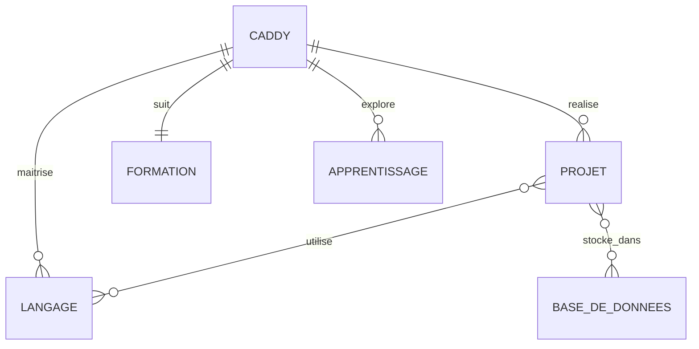

<div align="center">


</div>

| nom | role | ecole | ville |
|---|---|---|---|
| Caddy Rasolonjatovo | Développeur logiciel & Data Analyst | ENI Fianarantsoa (L3) | Fianarantsoa, Madagascar |

*(1 ligne)*

> Je vois mes compétences comme un modèle de données : des entités, et surtout les relations entre elles.
> Comprendre avant de construire.

## 📐 Modèle conceptuel

<p align="center">
  
</p>

<details>
<summary>Voir le même modèle en Mermaid</summary>



</details>

## 🧩 Table `competences`

```sql
SELECT categorie, string_agg(outil, ', ') AS outils
FROM competences
GROUP BY categorie;
```

| categorie | outils |
|---|---|
| langages | Java, PHP, JavaScript, C#, Python, R, **Elixir** *(en apprentissage)* |
| backend | Spring Boot, Laravel, Node.js |
| frontend | Vue.js, React, Bootstrap |
| desktop | JavaFX, Qt Creator |
| bases_de_donnees | MySQL, PostgreSQL, Oracle |
| data | Pandas, NumPy, Matplotlib, R |
| modelisation | Merise, UML |
| outils | Git, GitHub, Docker, Postman, VS Code |

<p align="center">
  
</p>

## 📁 Table `projets`

```sql
SELECT nom, type, stack FROM projets ORDER BY id;
```

| nom | type | stack |
|---|---|---|
| [Interventions techniques](https://github.com/matrix05-c/ProjetProjet) | Web (stage JIRAMA) | Laravel, Vue.js, MySQL, Bootstrap |
| [Station-service](https://github.com/matrix05-c/php-Projet) | Web | Laravel, Vue.js, MySQL |
| [Bibliothèque](https://github.com/matrix05-c/gestion-bibliotheque) | Desktop | JavaFX, MaterialFX, PostgreSQL |
| [Gestion des salaires](https://github.com/matrix05-c/SalarieManagement) | Web | Laravel, Vue.js, Bootstrap |
| [Parking](https://github.com/matrix05-c/ParkingGestion) | Desktop | C#, MaterialDesign |
| [Reservia](https://github.com/matrix05-c/Reservia) | Web | React, Tailwind CSS |
| [E-commerce Data Analysis](https://github.com/matrix05-c/dataAnalyser) | Data | Python, NumPy, Pandas, Matplotlib |

## 🔄 Transaction en cours


## 📬 `contact`

| canal | lien |
|---|---|
| portfolio | [caddy.is-a.dev](https://caddy.is-a.dev) |
| linkedin | [caddy-rasolonjatovo](https://www.linkedin.com/in/caddy-rasolonjatovo-46426b35b) |
| email | [caddyrasolonjatovo@gmail.com](mailto:caddyrasolonjatovo@gmail.com) |
