<div align="center">
  
</div>

<p align="center">
  
</p>

### 🧪 `Caddy.stack/0`

<p align="center">
  
</p>

### 🏢 `Caddy.experience/0`

```elixir
%{
  poste: "Développeur full-stack (stage)",
  entreprise: "JIRAMA",
  lieu: "Antsirabe",
  periode: ~D[2025-09-01]..~D[2025-12-31],
  stack: [:laravel, :vuejs, :mysql, :bootstrap]
}
```

### 🗂️ `Caddy.projets/0`

- **[Interventions techniques](https://github.com/matrix05-c/ProjetProjet)** : planification et suivi des interventions terrain (Laravel, Vue.js, MySQL)
- **[Station-service](https://github.com/matrix05-c/php-Projet)** : suivi des ventes et gestion du stock de carburant (Laravel, Vue.js, MySQL)
- **[Bibliothèque](https://github.com/matrix05-c/gestion-bibliotheque)** : gestion des livres, prêts et usagers (JavaFX, PostgreSQL)
- **[Parking](https://github.com/matrix05-c/ParkingGestion)** : entrées, sorties et places disponibles (C#)
- **[E-commerce Data Analysis](https://github.com/matrix05-c/dataAnalyser)** : indicateurs et visualisation des ventes (Python, Pandas, NumPy, Matplotlib)

### 📫 `Caddy.contact/0`

<p>
  <a href="https://caddy.is-a.dev"></a>
  <a href="https://www.linkedin.com/in/caddy-rasolonjatovo-46426b35b"></a>
  <a href="mailto:caddyrasolonjatovo@gmail.com"></a>
</p>


