<p align="center">
  
</p>

## Hey, I'm Caddy 👋

**Software Developer & Data Analyst** from Fianarantsoa, Madagascar.
Third-year student in Software Engineering and Database Systems at ENI Fianarantsoa.

I care about what happens *behind the interface*: the logic, the structure and the mechanisms that make a system work. Good design over complexity, simple over clever.

```console
iex> Caddy.skills() |> Enum.group_by(& &1.area)
```

<p align="center">
  
</p>

```console
iex> Caddy.experience() |> List.first()
%{role: "Full-stack developer (intern)", company: "JIRAMA", city: "Antsirabe",
  from: ~D[2025-09-01], to: ~D[2025-12-31], stack: [:laravel, :vue, :mysql]}
```

```console
iex> Caddy.projects() |> Enum.take(4)
```

<table>
  <tr>
    <td width="50%">
      <a href="https://github.com/matrix05-c/ProjetProjet"><b>🔧 Technical interventions</b></a><br/>
      Plan, track and organize field interventions. Built during my JIRAMA internship.<br/>
      <code>Laravel</code> <code>Vue.js</code> <code>MySQL</code>
    </td>
    <td width="50%">
      <a href="https://github.com/matrix05-c/dataAnalyser"><b>📈 E-commerce Data Analysis</b></a><br/>
      Process sales data, extract key indicators and chart them for decisions.<br/>
      <code>Python</code> <code>Pandas</code> <code>NumPy</code> <code>Matplotlib</code>
    </td>
  </tr>
  <tr>
    <td width="50%">
      <a href="https://github.com/matrix05-c/gestion-bibliotheque"><b>📚 Library</b></a><br/>
      Desktop app to organize books, track loans and manage users.<br/>
      <code>JavaFX</code> <code>PostgreSQL</code>
    </td>
    <td width="50%">
      <a href="https://github.com/matrix05-c/php-Projet"><b>⛽ Fuel station</b></a><br/>
      Track sales and manage the stock of a fuel station.<br/>
      <code>Laravel</code> <code>Vue.js</code> <code>MySQL</code>
    </td>
  </tr>
</table>

```console
iex> Caddy.contact()
```


[](https://caddy.is-a.dev)
[](https://www.linkedin.com/in/caddy-rasolonjatovo-46426b35b)
[](mailto:caddyrasolonjatovo@gmail.com)


